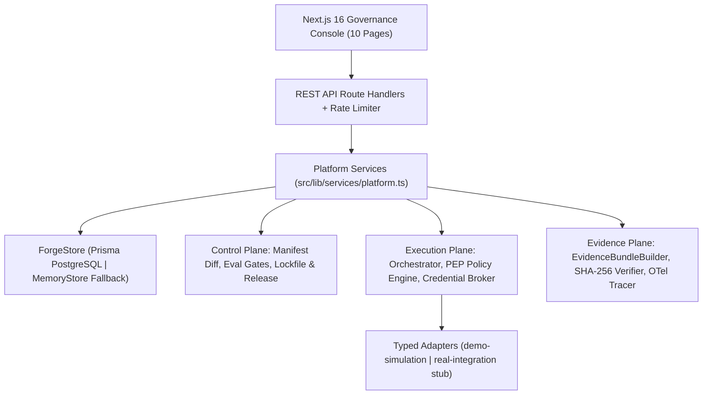

# AI Forge — Architecture

> **AI Forge** is the enterprise delivery, trust, and cryptographic evidence plane for autonomous AI agents.
> Aligned with `ai-forge/` implementation and `../ai-forge-blueprint/docs/architecture.md` + ADRs 001–003.

## 1. Three-Plane Architecture

AI Forge strictly separates agent governance into three logical planes:

1. **Control Plane (`src/lib/domain/{manifest,contract,release,eval,policy,approval,audit}`)**:
   - Versioned `AgentManifest` (`agentforge.dev/v1alpha1`) with canonical JSON SHA-256 digests (`src/lib/domain/manifest/digest.ts`).
   - Semantic Manifest Diff & Blast-Radius Risk Calculator (`src/lib/domain/manifest/diff.ts`) for `ChangeProposal` review.
   - `CapabilityContract` registry with declared actions, effect classes (`read | write | delete | execute | external_call`), and data classifications (`public | internal | confidential | restricted`).
   - Deterministic `EvaluationSuite` runner (`src/lib/domain/eval/runner.ts`) and release gates (`src/lib/domain/eval/gates.ts`) across 7 security and adversarial scenarios.
   - Immutable `AgentRelease` and `AgentLockfile` (`src/lib/domain/release/lockfile.ts`) signed and pinned by `releaseDigest`.
2. **Execution Plane (`src/lib/domain/runtime/*` + `src/lib/adapters/*`)**:
   - Resolves exact `releaseDigest` before execution; blocks unverified, revoked, or kill-switched agents.
   - Evaluates the deterministic Policy Enforcement Point (`src/lib/domain/policy/engine.ts`) **before every tool invocation**. No authorization ever originates from the LLM.
   - Issues ephemeral, scoped `DelegatedCredential` tokens (`src/lib/domain/runtime/credential-broker.ts`) bound to `(runId, releaseDigest, capability, action, resource)`.
   - Enforces runtime cost, tool-call, and duration budgets (`src/lib/domain/runtime/budget.ts`) and Human-in-the-Loop approvals (`src/lib/domain/approval/service.ts`), including closed-loop post-approval execution of `DemoDraftCommentAdapter`.
3. **Evidence Plane (`src/lib/domain/evidence/*` + `src/lib/telemetry/tracer.ts`)**:
   - Records structured `RunEvent`, `PolicyDecision`, `ToolInvocation`, and OpenTelemetry-compatible spans (`agent.release.create`, `evaluation.run`, `policy.decision`, `capability.invoke`, `agent.run`, `evidence.bundle.finalize`).
   - Constructs a tamper-evident `EvidenceBundle` (`src/lib/domain/evidence/bundle.ts`) with a canonical SHA-256 `bundleDigest`.
   - Verifies cryptographic integrity on-demand (`src/lib/domain/evidence/verify.ts`), detecting any post-hoc tampering of findings, cost, policy decisions, or lockfile digests.

## 2. Persistence & Dual-Store Architecture

| Backend | Activation Condition |
|---|---|
| **Prisma / PostgreSQL** | `DATABASE_URL` configured and reachable (`AI_FORGE_STORE=prisma` or default) |
| **MemoryStore** | Zero-dependency fallback when `AI_FORGE_STORE=memory` or PostgreSQL is unreachable |

All service paths (`startRunService`, `createCommitService`, `createChangeProposalService`, `createReleaseService`, `decideApprovalService`, `searchEvidenceBundlesService`) persist through `ForgeStore`.

## 3. Implemented API Surface

| Method | Route | Description |
|---|---|---|
| `GET` | `/api/overview` | Aggregated platform posture, workspace isolation metrics, and audit trail |
| `GET / POST` | `/api/agents` | List agents (with workspace filtering) and create agents in isolated workspaces |
| `GET / PATCH` | `/api/agents/[agentId]` | Agent detail (commits, proposals, releases, runs, capabilities, policies) + kill switch |
| `GET / POST` | `/api/agents/[agentId]/commits` | List commits or create validated manifest commit with semantic diff |
| `GET / POST / PATCH` | `/api/agents/[agentId]/proposals` | List, create, and approve/reject/merge `ChangeProposal` records |
| `GET / POST` | `/api/agents/[agentId]/releases` | List releases or run eval gates + publish immutable `AgentRelease` |
| `GET` | `/api/agents/[agentId]/releases/[releaseId]` | Inspect release lockfile, scorecard, and SHA-256 digest |
| `GET / POST` | `/api/agents/[agentId]/runs` | List runs or start a governed run bound to `releaseDigest` across 7 scenarios |
| `GET` | `/api/agents/[agentId]/runs/[runId]` | Single-pane-of-glass run detail (events, policy decisions, tools, approvals, OTel spans, live SHA-256 verification) |
| `GET` | `/api/agents/[agentId]/runs/[runId]/evidence` | Download canonical `EvidenceBundle` JSON |
| `GET` | `/api/approvals` | List pending and decided Human-in-the-Loop approvals |
| `GET / PATCH` | `/api/approvals/[approvalId]` | Approve or deny with mandatory justification; executes draft comment post-approval |
| `POST` | `/api/evals/[suiteId]/run` | Run deterministic 7-scenario evaluation suite and compute scorecard |
| `POST` | `/api/policies/evaluate` | Evaluate single PEP input or run the 9-rule policy regression suite (`runAllRules`) |
| `GET` | `/api/evidence` | Search and filter `EvidenceBundle` records across runs with live cryptographic verification |
| `POST` | `/api/evidence/verify` | Verify any `EvidenceBundle` JSON payload against canonical SHA-256 and lockfile digests |
| `POST` | `/api/demo/run-security-audit` | 1-click end-to-end execution of any of the 7 `Security PR Auditor` scenarios |
| `*` | `/api/auth/[...nextauth]` | NextAuth credentials provider + RBAC session context |

## 4. Implemented Console Pages

| Route | Purpose |
|---|---|
| `/` | **Overview**: 5-second trust chain, live telemetry, 7-scenario adversarial launcher, workspace isolation table, OWASP Agentic Top 10 matrix |
| `/agents` | **Agents**: Workspace filter, Create Agent modal in isolated environment, autonomy badges, kill switch |
| `/agents/[agentId]` | **Agent Detail**: 8 tabs (`Overview`, `Manifest`, `Releases`, `Evals`, `Capabilities`, `Policies`, `Runs`, `Evidence`) |
| `/agents/[agentId]/manifest` | **Manifest Editor**: Live Zod + business validation, semantic diff & blast-radius risk table, 3 presets, commit/proposal/release actions |
| `/agents/[agentId]/releases/[releaseId]` | **Release Detail**: Live lockfile SHA-256 verification, canary/environment status, scorecard & gates |
| `/agents/[agentId]/runs/[runId]` | **Run Detail**: Single-pane-of-glass cost, latency, tools, release, policy, trace, findings cards, live SHA-256 evidence verification |
| `/approvals` | **Approvals**: HITL approval/denial with mandatory justification and post-approval execution receipt |
| `/capabilities` | **Capabilities**: Capability contracts, effect classes, approval rules, and JSON contract inspector |
| `/policies` | **Policy Center**: 9 ordered deterministic rules, 1-click presets, simulator, and 9-rule regression suite runner |
| `/evidence` | **Evidence Explorer**: Multi-criteria search + interactive SHA-256 integrity verifier & tamper-detection simulator |
