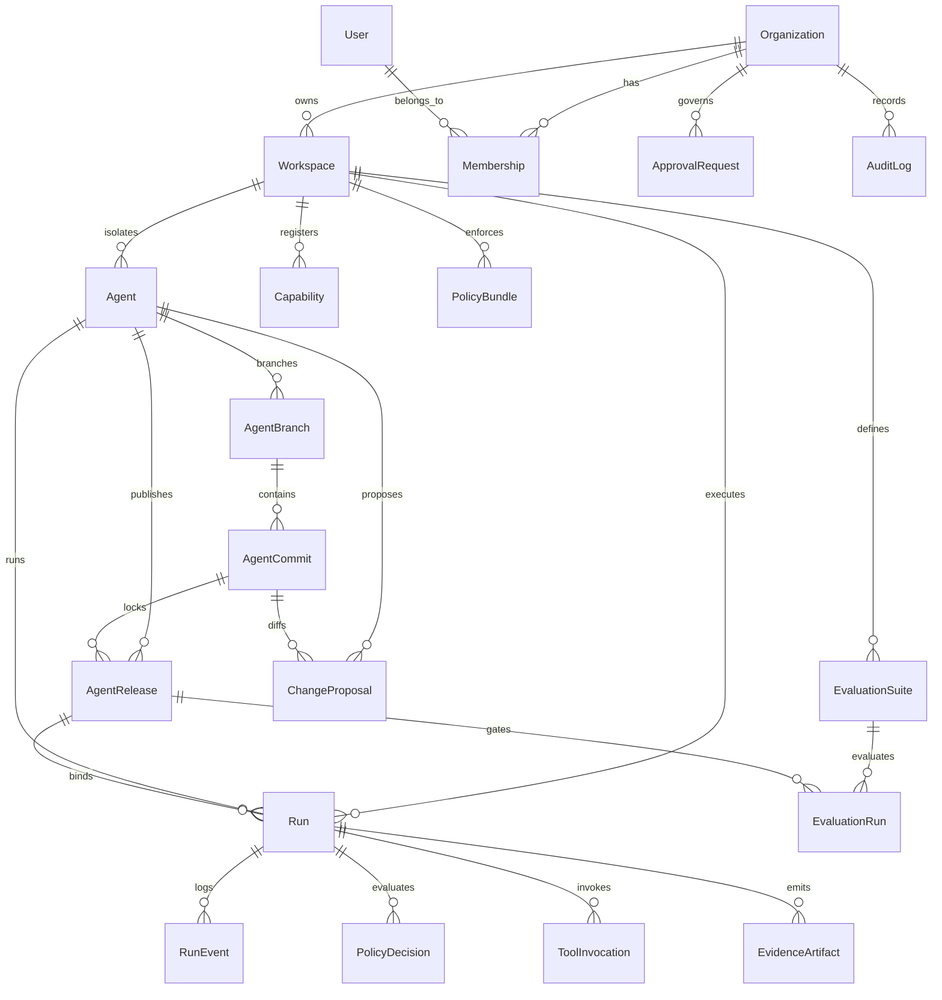

# AI Forge — Entity Diagram & Database Schema

All 18 mandatory domain entities from Section 8 of the specification are modeled in [`prisma/schema.prisma`](../prisma/schema.prisma).

## 1. Entity-Relationship Diagram (18 Entities)



## 2. Entity Inventory

| # | Entity | Purpose |
|---|---|---|
| 1 | `Organization` | Top-level tenant boundary (`id`, `slug`, `name`) |
| 2 | `Workspace` | Environment isolation boundary (`development`, `staging`, `production`) |
| 3 | `User` | Authenticated human operator (`email`, `name`, `status`) |
| 4 | `Membership` | RBAC binding (`owner`, `admin`, `operator`, `viewer`, `auditor`) |
| 5 | `Agent` | Registered AI agent (`slug`, `name`, `status`, `killSwitch`) |
| 6 | `AgentBranch` | Git-like branch pointer (`name`, `headCommitId`) |
| 7 | `AgentCommit` | Immutable manifest snapshot (`manifestJson`, `digest`, `parentCommitId`) |
| 8 | `ChangeProposal` | Governance PR (`sourceCommitId`, `targetBranchId`, `diffJson`, `riskSummary`, `status`) |
| 9 | `AgentRelease` | Signed immutable release (`releaseDigest`, `lockfileJson`, `policyDigest`, `status`) |
| 10 | `Capability` | Versioned tool/connector contract (`slug`, `version`, `contractJson`, `digest`, `trustTier`) |
| 11 | `PolicyBundle` | Deterministic PEP policy bundle (`version`, `digest`, `sourceText`) |
| 12 | `EvaluationSuite` | Dataset & release gates (`name`, `version`, `datasetJson`, `gatesJson`) |
| 13 | `EvaluationRun` | Scorecard execution record (`releaseId`, `status`, `scorecardJson`) |
| 14 | `Run` | Governed runtime execution (`agentReleaseId`, `status`, `inputHash`, `outputHash`, `traceId`) |
| 15 | `RunEvent` | Ordered state-machine & lifecycle events (`sequence`, `type`, `payloadRedactedJson`) |
| 16 | `PolicyDecision` | Pre-invocation PEP decision (`action`, `resource`, `decision`, `reasonCode`, `policyDigest`) |
| 17 | `ToolInvocation` | Connector execution telemetry (`capability`, `action`, `status`, `latencyMs`, `costUsd`) |
| 18 | `ApprovalRequest` | Human-in-the-Loop gate (`resourceType`, `resourceId`, `decision`, `reason`, `approverId`) |
| 19 | `EvidenceArtifact` | Cryptographic evidence artifact (`type`, `uri`, `digest`, `classification`) |
| 20 | `AuditLog` | Append-only organizational audit log (`actorType`, `actorId`, `action`, `metadataJson`) |

## 3. Migration & Seed Instructions

```bash
# 1. Start local PostgreSQL
docker compose up -d

# 2. Generate Prisma Client and push schema
npx prisma generate
npx prisma db push

# 3. Seed demo organization, workspaces, Security PR Auditor, release, and initial run
npm run db:seed
```

